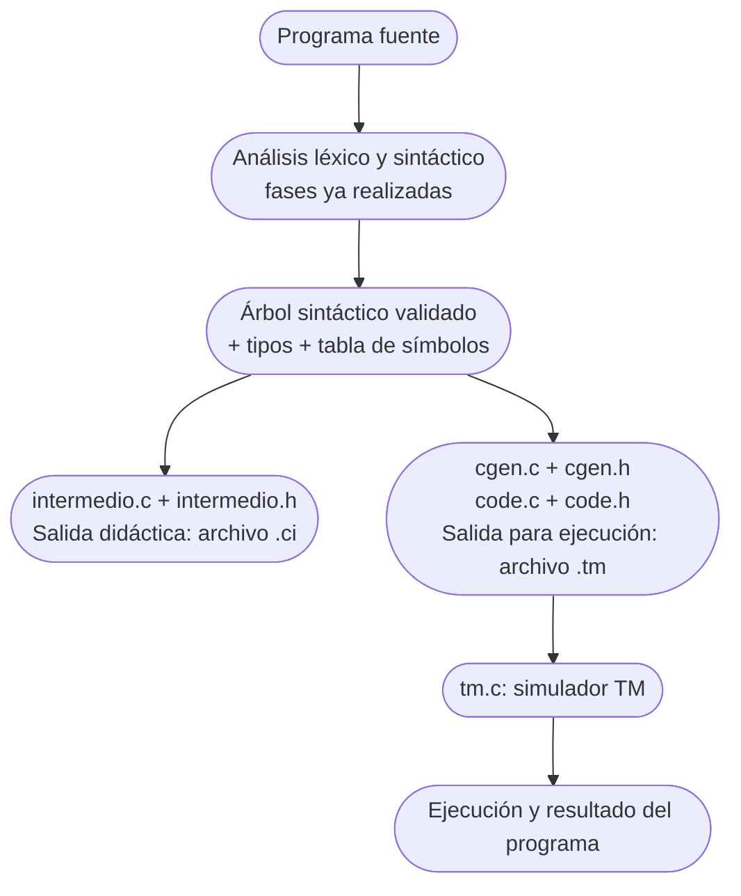

# Entrega Final del Proyecto: Compiladores II

**Institución:** Benemérita Universidad Autónoma de Aguascalientes (UAA)  
**Centro:** Centro de Ciencias Básicas — Departamento de Sistemas Electrónicos  
**Carrera:** Ingeniería en Sistemas Computacionales  
**Modalidad:** Actividad final por equipos  
**Docente:** Dra. Blanca Guadalupe Estrada Rentería  

## Del árbol semántico a la ejecución en TM

> **OBJETIVO CENTRAL.** Demostrar que su compilador es capaz de generar instrucciones correctas para la máquina objetivo TM y ejecutarlas para obtener el resultado esperado. No basta con mostrar la salida del programa: se evaluarán por separado el código producido y su ejecución.

---

## 1. Objetivo de la fase final

En Compiladores I y II han construido las etapas de análisis de su compilador. En esta fase utilizarán el árbol ya validado semánticamente y la información de la tabla de símbolos para completar la generación de código destinado a la máquina TM (*Tiny Machine*). El trabajo final consiste en integrar esa generación a su propio compilador, presentar el código producido y demostrar su ejecución.

## 2. Punto de partida: el árbol semántico terminado

Cada equipo deberá partir de su compilador existente, que ya cuenta con análisis léxico, sintáctico y semántico, árbol sintáctico validado y tabla de símbolos. Antes de generar instrucciones se debe haber comprobado que las expresiones, los identificadores y sus tipos cumplen las reglas del lenguaje del proyecto.

En el proyecto TINY de referencia, el árbol se representa mediante `TreeNode`, con nodos de sentencia (`StmtK`) y de expresión (`ExpK`), arreglos `child` para los hijos, `sibling` para sentencias hermanas y atributos como `attr.name`, `attr.val` y `attr.op`. Si su compilador utiliza otra representación, deben establecer una correspondencia real entre los nodos de su árbol y las operaciones que generará la TM; no basta con copiar el generador.

## 3. ¿Qué sigue después del análisis semántico?

El generador recorre el árbol y reconoce la operación de cada nodo. Para una constante carga un valor; para un identificador consulta su ubicación en memoria; para una expresión compuesta evalúa los operandos y produce la operación TM; y para las sentencias emite las instrucciones de lectura, almacenamiento, salida o control de flujo que correspondan. Las funciones de emisión escriben esas instrucciones en un archivo de texto con el formato esperado por TM.

### Diagrama de flujo de compilación y ejecución



*Ruta del proyecto disponible cargado en su aula virtual. El archivo `.ci` y el archivo `.tm` se producen por caminos paralelos desde el mismo árbol: el `.ci` no es la entrada directa de la TM.*

---

## 4. Archivos para la generación de código

### 4.1. `cgen.h`: interfaz del generador

Declara la función `codeGen(TreeNode *syntaxTree, char *codefile)`. Permite que otro módulo, como `main.c`, invoque la generación de instrucciones TM utilizando el árbol y el nombre del archivo destino. No contiene el algoritmo que recorre el árbol ni escribe las instrucciones.

* **¿QUÉ LES RESUELVE?** Proporciona una interfaz para llamar al generador. Deben incluirla donde se invoque `codeGen` y asegurar que la definición de `TreeNode` esté disponible mediante los encabezados pertinentes.

### 4.2. `cgen.c`: decisiones de traducción

Implementa `codeGen` y sus rutinas internas `cGen`, `genStmt` y `genExp`. `cGen` recorre los nodos y sus hermanos; `genStmt` trata los tipos `IfK`, `RepeatK`, `AssignK`, `ReadK` y `WriteK`; `genExp` trata `ConstK`, `IdK` y `OpK`. Para variables, consulta la tabla con `st_lookup`. Para producir instrucciones utiliza `emitRO`, `emitRM` y las funciones de ajuste de saltos definidas en `code.c`.

El archivo cubre las operaciones que aparecen explícitamente en su código: suma, resta, multiplicación, división, comparación menor que y comparación de igualdad. El recorrido de operadores utiliza el acumulador `ac`, el segundo acumulador `ac1` y posiciones temporales referidas a `mp`. Para un `if` reserva instrucciones de salto y las completa cuando conoce sus destinos; para `repeat` emite un salto hacia el inicio del cuerpo cuando la condición es falsa.

* **¿QUÉ LES RESUELVE?** La estrategia de traducción del árbol TINY a instrucciones TM para las construcciones reconocidas. El equipo debe comprobar cuáles de esas construcciones coinciden con su lenguaje y adaptar explícitamente cualquier nodo u operación diferente que forme parte de su proyecto.

### 4.3. `code.h`: convenciones y funciones disponibles

Define las convenciones de registros del generador:

* $\text{pc} = 7$ (contador del programa)
* $\text{mp} = 6$ (referencia para temporales)
* $\text{gp} = 5$ (referencia para variables globales)
* $\text{ac} = 0$ (acumulador)
* $\text{ac1} = 1$ (segundo acumulador)

Declara `emitComment`, `emitRO`, `emitRM`, `emitSkip`, `emitBackup`, `emitRestore` y `emitRM_Abs`.

* **¿QUÉ LES RESUELVE?** Establece los registros que utilizará el generador y ofrece los prototipos de las operaciones de emisión. No guarda por sí mismo el programa generado ni interpreta instrucciones.

### 4.4. `code.c`: escritura de las instrucciones TM

Implementa las siete funciones declaradas en `code.h`:

* `emitRO`: escribe instrucciones de tres registros, como `MUL`.
* `emitRM`: escribe instrucciones con desplazamiento y registro base, como `LD`, `ST` o `LDC`.
* `emitComment`: incorpora comentarios cuando `TraceCode` está activo.
* `emitLoc`: lleva la posición que se está escribiendo.
* `highEmitLoc`: registra la posición más alta alcanzada.
* `emitSkip`: reserva posiciones de código para completar saltos.
* `emitBackup`: regresa a una posición reservada.
* `emitRestore`: devuelve el punto de escritura al final.
* `emitRM_Abs`: calcula el desplazamiento relativo al contador del programa mediante $a - (\text{emitLoc} + 1)$.

Las funciones escriben en el flujo `FILE *code` que abre el compilador; no ejecutan el código TM.

* **¿QUÉ LES RESUELVE?** El formato textual de las instrucciones, su numeración y el ajuste de saltos. `cgen.c` determina qué emitir y `code.c` se encarga de escribirlo.

---

## 5. ¿Qué resuelve cada archivo?

| Archivo | Responsabilidad | Recibe | Produce / Relación |
| :--- | :--- | :--- | :--- |
| `cgen.h` | Declarar `codeGen` | `TreeNode` y nombre del archivo | Interfaz que puede invocar `main.c`. |
| `cgen.c` | Recorrer el árbol y elegir instrucciones TM | Árbol validado; tabla de símbolos mediante `st_lookup` | Llama a funciones de emisión de `code.c`. |
| `code.h` | Definir registros y prototipos de emisión | Convenciones de registros y parámetros de funciones | Interfaz utilizada por `cgen.c` y `code.c`. |
| `code.c` | Escribir instrucciones y resolver posiciones/saltos | Operaciones, registros, desplazamientos y `FILE *code` | Texto del archivo `.tm`, utilizado después por `tm.c`. |

---

## 6. Otros módulos que intervienen en el proyecto verificado

La generación de código no trabaja de forma aislada:

* `analyze.c`: construye la tabla de símbolos y verifica tipos.
* `symtab.c`: proporciona la función `st_lookup` para recuperar la posición asignada a una variable.
* `globals.h`: define `TreeNode`, los tipos de nodo, los tokens, `FILE *code` y las banderas de análisis.
* `main.c`: coordina las fases y abre los archivos de salida.
* `tm.c`: carga y ejecuta las instrucciones de la máquina.

En la ampliación didáctica también se encuentran `intermedio.h` e `intermedio.c`. Estos módulos implementan `generarCodigoIntermedio(TreeNode *raiz, FILE *destino)`, que recorre el árbol y genera código de tres direcciones con temporales y etiquetas en un archivo `.ci`. Se trata de una salida adicional para su estudio; no reemplaza a `codeGen` ni transforma el `.ci` en un `.tm`.

---

## 7. ¿Cómo integrarán la generación de código a su compilador?

1. **Identifiquen la estructura real del árbol validado de su compilador.** Comparen sus tipos de nodo, atributos, hijos, operadores y sentencias con los valores usados en `cgen.c`. Documenten las diferencias antes de realizar cambios.
2. **Verifiquen que el análisis semántico construye o conserva la tabla de símbolos y detecta errores.** El generador debe recibir un árbol válido; el proyecto de referencia solamente genera las salidas cuando la bandera `Error` permanece en `FALSE`.
3. **Incorporen los módulos de generación al proyecto y mantengan disponibles sus dependencias.** En la implementación analizada, `cgen.c` incluye `globals.h`, `symtab.h`, `code.h` y `cgen.h`; `code.c` incluye `globals.h` y `code.h`. La interfaz `cgen.h` declara `codeGen`.
4. **Conecten los identificadores del árbol con las posiciones reales de memoria.** En la referencia, `st_lookup(tree->attr.name)` recupera el desplazamiento de cada variable. Si su tabla de símbolos utiliza otro mecanismo, deben adaptar esa consulta de forma consistente.
5. **Desde el punto del programa que coordina las fases, abran la salida destinada a las instrucciones TM**, llamen a `codeGen` con el árbol validado y cierren el archivo. El `main.c` proporcionado ya realiza esas operaciones. Comprueben que el archivo generado contiene instrucciones TM reales y no únicamente el árbol o mensajes de depuración.
6. **Si mantienen la extensión didáctica**, conserven la generación de `.ci` mediante `generarCodigoIntermedio`. Deben identificarla claramente como código intermedio de tres direcciones.
7. **Permitan que el usuario visualice el código `.tm`** correspondiente al programa fuente recién compilado y muestre el archivo `.ci`.
8. **Conecten la salida `.tm` con el simulador de la TM** y permitan observar su ejecución, las entradas solicitadas y el resultado. El simulador debe recibir el código generado, no el programa fuente ni el archivo `.ci`.
9. **Comprueben que cada nueva compilación corresponde al programa fuente** que se está revisando y que los errores de análisis, generación o ejecución se informan sin presentar una salida previa como si fuera válida.

---

## 8. Del árbol validado a una instrucción TM: ejemplo de referencia

En el programa factorial de TINY, el árbol contiene la asignación `fact := fact * x`. En la tabla de símbolos del ejemplo, `x` tiene el desplazamiento `0` y `fact` el desplazamiento `1` respecto de `gp` (registro `5`). `cgen.c` evalúa el primer identificador y guarda su valor temporalmente, evalúa el segundo y realiza la multiplicación, y finalmente almacena el resultado en `fact`.

```text
16: LD  0,1(5)    * cargar fact en ac (registro 0)
17: ST  0,0(6)    * conservar fact temporalmente respecto de mp
18: LD  0,0(5)    * cargar x en ac
19: LD  1,0(6)    * recuperar fact en ac1 (registro 1)
20: MUL 0,1,0     * calcular fact * x en ac
21: ST  0,1(5)    * escribir el nuevo valor de fact
```

Las instrucciones anteriores son las direcciones `16` a `21` del listado TM del factorial incluido en el proyecto. Este ejemplo muestra por qué una sola asignación del lenguaje fuente requiere varias instrucciones de carga, almacenamiento y operación. En cambio, la extensión de código intermedio escribe el cálculo con un temporal simbólico, por ejemplo:

```text
t2 = fact * x;
fact = t2;
```

Ese temporal no corresponde directamente a una dirección física o un registro del listado TM.

Para un `if` o un `repeat` también deberán explicar cómo el generador determina destinos de salto. La TM maneja direcciones numéricas y desplazamientos relativos al contador del programa; no ejecuta etiquetas simbólicas como `L1` y `L2`. En el proyecto de Louden, esta correspondencia se resuelve con las funciones de `code.c`.

---

## 9. Visualización del código generado

La versión final deberá ofrecer un área, ventana o componente claramente identificado como **"Código Intermedio"**, donde pueda revisarse el código `.tm` correspondiente al programa que acaba de compilarse. Deben poder distinguirse las instrucciones, sus direcciones y los operandos que aparecen en el archivo. No basta con mostrar el mensaje *"compilación correcta"*.

Si la interfaz incluye el archivo `.ci`, su visualización será adicional y deberá estar rotulada como **"Código intermedio de tres direcciones"**. El compilador de referencia aporta ambas salidas en archivos de texto, pero no incluye una interfaz gráfica que las muestre automáticamente: esa conexión entre la salida de archivos y la interfaz sí corresponde a cada equipo.

---

## 10. Ejecución en TM y resultado

La versión final deberá permitir comprobar que el archivo `.tm` generado se carga en el simulador TM y se ejecuta. En la consola o mecanismo equivalente se observarán las entradas cuando la instrucción `IN` las solicite y las salidas que produzca `OUT`. El resultado mostrado deberá corresponder al programa fuente y a los datos utilizados durante la revisión.

El archivo `tm.c` del proyecto contiene el simulador y sus operaciones de ejecución y consulta; no realiza el análisis semántico ni genera las instrucciones TM. Una visualización de código correcta sin ejecución no cubre el segundo criterio de evaluación.

---

## 11. ¿Qué tienen y qué les corresponde completar?

| El material de referencia ya proporciona | El equipo debe integrar, adaptar o desarrollar |
| :--- | :--- |
| Un recorrido y generación TM para los nodos TINY contemplados por `cgen.c`. | Ajustar el recorrido y el tratamiento de nodos cuando su lenguaje o su árbol difieran de TINY. |
| Utilidades de emisión y ajuste de saltos en `code.c` y `code.h`. | Vincularlas correctamente con la representación del árbol, la memoria y la tabla de símbolos de su proyecto. |
| Escritura de archivos `.tm` desde `main.c` y carga/ejecución con `tm.c` en el proyecto analizado. | Conectar esas fases a la forma en que se ejecuta su compilador y asegurar la correspondencia entre el fuente actual y el código ejecutado. |
| Generación didáctica de `.ci` mediante `intermedio.c`/`intermedio.h`. | Mantener diferenciadas la vista `.ci` y la vista `.tm`, si emplean ambas. |
| Salida textual del árbol, la tabla de símbolos y los archivos de código. | Incorporar los componentes de visualización solicitados en su interfaz y presentar la ejecución. |

---

## 12. Qué deberá demostrar el compilador terminado

Durante la revisión, para cada programa que indique la docente, el equipo deberá:

1. Cargar/programar el programa fuente.
2. Procesarlo con su compilador.
3. Demostrar que se obtuvo un árbol válido.
4. Generar el archivo de instrucciones TM.
5. Mostrar en el área correspondiente el código de ese programa.
6. Ejecutar el código en la TM.
7. Comprobar el resultado.

> La presentación del código generado y su ejecución son evidencias independientes.

---

## 13. Dinámica de la revisión por equipo

La revisión práctica será por equipo. A cada equipo se le proporcionará un conjunto de cinco programas que deberán procesarse en el momento de su revisión utilizando su propio compilador. No debe asumirse que serán exactamente los ejemplos utilizados durante el desarrollo. Los programas de prueba y las fechas se comunicarán posteriormente.

Para cada uno de los cinco programas, el equipo deberá demostrar tanto la generación correcta del código como su ejecución y resultado. El compilador deberá estar funcional y el ambiente de trabajo preparado antes de presentarse.

---

## 14. Criterios de evaluación: cinco programas, diez puntos

Cada programa tendrá un valor máximo de dos puntos: uno por la generación correcta y visualización clara del código TM correspondiente, y uno por su ejecución correcta en la TM con el resultado esperado.

| Programa | Código TM correcto y visible | Ejecución correcta | Total |
| :--- | :---: | :---: | :---: |
| Programa 1 | 1 punto | 1 punto | 2 puntos |
| Programa 2 | 1 punto | 1 punto | 2 puntos |
| Programa 3 | 1 punto | 1 punto | 2 puntos |
| Programa 4 | 1 punto | 1 punto | 2 puntos |
| Programa 5 | 1 punto | 1 punto | 2 puntos |
| **TOTAL** | **5 puntos** | **5 puntos** | **10 puntos** |

El punto de generación se obtiene solamente si el compilador procesa el programa y produce instrucciones que corresponden correctamente a él y que pueden revisarse en la interfaz. El punto de ejecución se obtiene solamente si el código generado se ejecuta en TM y produce el resultado esperado. La evaluación no se limita a confirmar que *"corre"*.

---

## 15. Valor del proyecto: 25% de la materia

La calificación de esta revisión se expresa sobre $10$ puntos. Esa calificación corresponde al proyecto final, el cual representa el $25\%$ de la calificación del curso.

## 16. Día de revisión

La revisión práctica se realizará únicamente el día que corresponda a su grupo. Las fechas específicas serán comunicadas por el grupo. El equipo deberá presentarse con el compilador funcional, el simulador TM disponible y el ambiente necesario para compilar, mostrar el código y ejecutar los programas durante la sesión. Es responsabilidad del equipo prever previamente problemas de configuración.

## 17. Entrega final en el aula virtual

Una vez realizada y aprobada la revisión práctica, el equipo subirá a su aula virtual la entrega completa del compilador: proyecto completo, código fuente y archivos necesarios para compilarlo y ejecutarlo. Esta carga se realiza después de la revisión práctica, no en sustitución de ella.

## 18. Recomendaciones antes de la revisión

* Prueben previamente las expresiones y asignaciones que su lenguaje admite, así como las instrucciones de lectura y escritura.
* Comprueben el comportamiento de las condiciones y los ciclos que efectivamente soporta su compilador.
* Revisen que el archivo `.tm` mostrado en la interfaz corresponda siempre al programa fuente actual.
* Verifiquen que el simulador TM pueda cargar y ejecutar las instrucciones generadas y muestre las entradas y resultados esperados.
* Comprueben el proyecto en el mismo equipo y ambiente de desarrollo que utilizarán durante la revisión.
* Eviten dependencias innecesarias de rutas absolutas y comprueben que los archivos requeridos estén disponibles.
* Identifiquen claramente las construcciones que su compilador aún no soporta; no las presenten como implementadas.