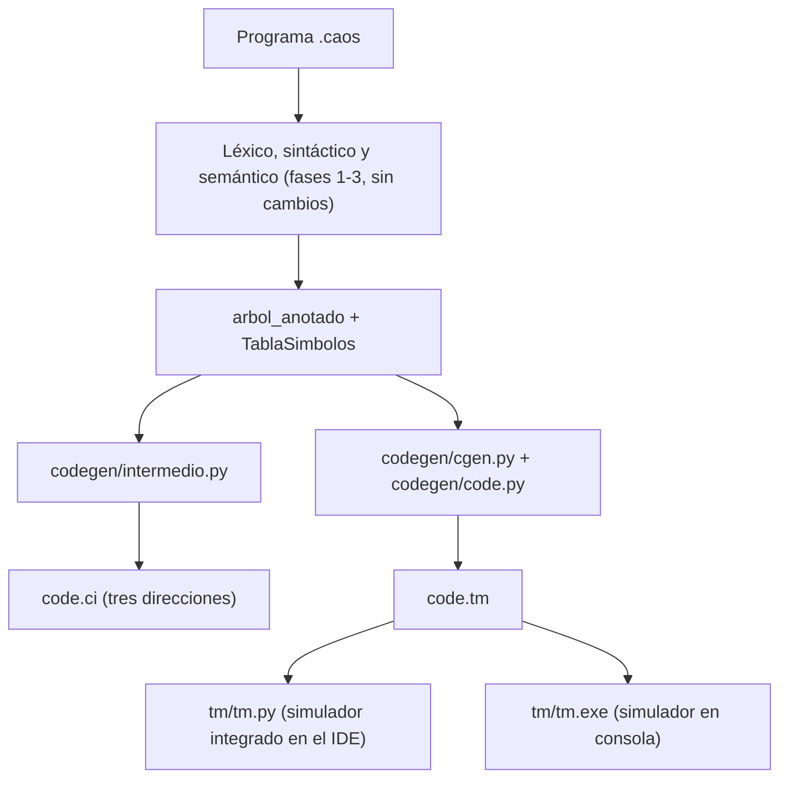

# Fase 4: generación de código intermedio y código objetivo TM

Esta fase toma el árbol que ya validó el análisis semántico y produce, por caminos paralelos:

- **`code.tm`**: instrucciones para la máquina TM (*Tiny Machine*). Es la entrada del simulador.
- **`code.ci`**: código intermedio de tres direcciones, con temporales y etiquetas. Es una salida didáctica: no se convierte en `.tm` ni lo ejecuta la TM.



## 1. Constancia: las fases anteriores no se modificaron

Las fases léxica, sintáctica y semántica ya estaban validadas y **no se modificaron** en esta fase:

- No se editó ningún archivo de `external_compiler/lexer/`, `external_compiler/parser/` ni `external_compiler/semantic/`.
- En `compiler_stub.py` siguen iguales `_run_lexico`, `_format_tokens`, `_run_sintactico` y `_run_semantico`, los bloques de `main()` de las fases 1 a 3, sus archivos de salida y sus códigos de salida (1, 2 y 3).
- Las pruebas existentes (`test_parser.py`, `test_parser_recovery.py`, `test_semantico.py`, `test_integracion.py` e `ide/test_semantic_output.py`) pasan sin cambios.

La generación solo **consume** los resultados de esas fases. La función nueva `_run_generacion` llama a la API pública `analizar(ASTFormatter.to_binary(ast))`, que es el mismo análisis determinista de la fase 3, y lee el árbol anotado y la tabla de símbolos sin modificarlos. Si algo no se puede traducir, se reporta con el prefijo `[GENERACION]` y el compilador termina con código 4, sin tocar las fases anteriores.

## 2. Archivos

| Archivo | Equivale en TINY a | Responsabilidad |
| :--- | :--- | :--- |
| `external_compiler/codegen/code.py` | `code.c` / `code.h` | Registros (`pc=7`, `mp=6`, `gp=5`, `ac=0`, `ac1=1`) y emisión: `emit_comment`, `emit_ro`, `emit_rm`, `emit_skip`, `emit_backup`, `emit_restore`, `emit_rm_abs`. |
| `external_compiler/codegen/cgen.py` | `cgen.c` / `cgen.h` | `code_gen`, `c_gen`, `gen_stmt` y `gen_exp`: recorren el árbol anotado y eligen las instrucciones TM. |
| `external_compiler/codegen/intermedio.py` | `intermedio.c` / `intermedio.h` | `generar_codigo_intermedio`: código de tres direcciones. |
| `external_compiler/compiler_stub.py` | `main.c` | Las fases `intermedio` y `ejecutar` escriben `code.tm`, `code.ci` e `intermediate.txt`. |
| `tm/tm.c` | `tm.c` | Simulador TM extendido para CAOS (consola). `tm/compilar_tm.bat` lo compila con gcc. |
| `tm/tm.py` | `tm.c` | El mismo simulador en Python (clase `TMSimulator`), usado por el IDE. |

## 3. Correspondencia entre el árbol de CAOS y el de TINY

TINY usa `TreeNode` con `nodekind` (`StmtK`/`ExpK`), `child[]`, `sibling` y `attr`. El árbol anotado de CAOS es un diccionario con `type`, `children` y atributos. La correspondencia es esta:

| Concepto TINY | CAOS (árbol anotado) |
| :--- | :--- |
| `tree->sibling` (sentencias hermanas) | lista `children` de `Programa`, `ListaDeclaracion`, `ListaSentencias` (BLOQUE) y `SeccionAST` |
| `tree->child[i]` | `children[i]`; en `if`/`while`/`do` las partes son secciones `SeccionAST` con `label_sintactico` `CONDICION`, `ENTONCES`, `SINO`, `CUERPO` o `CONDICION_UNTIL` |
| `tree->attr.name` | `identificador` (sentencias) o `nombre` (expresiones) |
| `tree->attr.val` | `valor` del `Literal` |
| `tree->attr.op` | `operador` de `OperacionBinaria` / `OperacionUnaria` |
| `st_lookup(name)` | `tabla.buscar(nombre).loc` (desplazamiento respecto de `gp`) |
| `tree->type` (`Integer`/`Boolean`) | `tipo_dato` (`int`, `float`, `bool`) que sintetizó el semántico |

| Nodo CAOS | Nodo TINY | Traducción TM |
| :--- | :--- | :--- |
| `Asignacion` | `AssignK` | expresión en `ac`; `ST ac,loc(gp)` |
| `EntradaEstandar` (`cin`) | `ReadK` | `IN` (int/bool) o `INF` (float); `ST ac,loc(gp)`. Un bool leído se normaliza a 0/1 |
| `SalidaEstandar` (`cout`) | `WriteK` | por elemento: `OUT` (int/bool), `OUTF` (float) u `OUTS` (cadena); al final `OUTLN` |
| `Seleccion` (`if`) | `IfK` | igual que TINY: `emitSkip` reserva el `JEQ` a la parte else y el `LDA` al final; se completan con `emitBackup` / `emitRestore`. Sin `else`, el salto llega al final |
| `Repeticion` (`do ... until`) | `RepeatK` | cuerpo, condición y `JEQ ac` hacia el inicio mientras la condición sea falsa |
| `Iteracion` (`while`) | *no existe* | inicio; condición; `JEQ ac` reservado hacia la salida; cuerpo; `LDA pc` de regreso al inicio; se completa el `JEQ` |
| `IncrementoDecremento` (`++`/`--`) | *no existe* | `LD`, `LDC ac1,1`, `ADD`/`SUB`, `ST` |
| `DeclaracionVariable` | *(no hay)* | solo un comentario con la localidad asignada |
| `Literal` | `ConstK` | `LDC ac,valor(0)`; `true`/`false` como 1/0; los reales como `LDC 0,2.5(0)` |
| `Identificador` | `IdK` | `LD ac,loc(gp)` |
| `OperacionBinaria` | `OpK` | izquierdo en `ac` → `ST ac,tmpOffset(mp)` → derecho en `ac` → `LD ac1,tmpOffset(mp)` → operación |
| `OperacionUnaria` (`!`) | *no existe* | `JEQ ac,2(pc)` con el patrón de 0/1 |
| `ConversionTipo` (int → float) | *no existe* | solo comentario: la TM extendida trabaja con reales y el entero ya es un real válido |

Operadores de `OpK`:

| Operador CAOS | TINY | Instrucciones TM |
| :--- | :--- | :--- |
| `+ - *` | `PLUS MINUS TIMES` | `ADD`, `SUB`, `MUL` |
| `/` | `OVER` | `DIV` (entera, trunca) si el `tipo_dato` es int; `DIVF` si es float |
| `%` | *no existe* | `a - (a/b)*b`: `DIV 2,1,0`, `MUL 2,2,0`, `SUB 0,1,2` (usa el registro 2 como auxiliar) |
| `^` | *no existe* | `POW`; si el resultado es int, se trunca con `DIV` entre 1 |
| `<` `==` | `LT` `EQ` | `SUB` + `JLT` / `JEQ` (mismo patrón de 4 instrucciones de TINY) |
| `<= > >= !=` | *no existe* | `SUB` + `JLE` / `JGT` / `JGE` / `JNE` |
| `&& \|\|` | *no existe* | cortocircuito: si el izquierdo ya decide, `JEQ`/`JNE` salta al resultado. Los saltos se completan con backpatch |

Las ramas que el semántico marcó como "no se ejecuta" sí generan código, porque en ejecución la condición depende de los datos leídos.

## 4. Extensiones de la TM para CAOS

La TM se adaptó a CAOS, y no al revés. Se conservan las 18 instrucciones de Louden, su formato y el ciclo de comandos (`g`, `s`, `r`, `i`, `d`, `t`, `p`, `c`, `h`, `q`). Los cambios son:

- Registros y memoria de datos en `double`, porque CAOS tiene `float`. `LDC` acepta constantes reales.
- `DIV` conserva la división entera que trunca hacia cero, igual que el análisis semántico.
- `IADDR_SIZE` = 8192 y `DADDR_SIZE` = 4096.
- Los opcodes se comparan con la palabra completa, ya que `OUT`, `OUTF`, `OUTS` y `OUTLN` comparten prefijo.
- `OUT` imprime solo el valor, para que la salida corresponda a lo que escribió `cout`.

| Instrucción nueva | Clase | Efecto |
| :--- | :--- | :--- |
| `INF r,0,0` | RR | lee un número real en `reg[r]` (`IN` sigue aceptando solo enteros) |
| `OUTF r,0,0` | RR | imprime `reg[r]` como real: hasta 6 decimales, sin ceros sobrantes, mínimo `x.0` |
| `OUTLN 0,0,0` | RR | imprime un salto de línea (fin de cada `cout`) |
| `DIVF r,s,t` | RR | `reg[r] = reg[s] / reg[t]` (real) |
| `POW r,s,t` | RR | `reg[r] = reg[s] ^ reg[t]` |
| `OUTS r,d(s)` | RM | imprime la cadena terminada en 0 que inicia en `dMem[d + reg[s]]` |

**Mapa de memoria de datos.** Las variables ocupan `0(gp)` en adelante, en el orden de la tabla de símbolos. Después se colocan las cadenas de `cout` (bytes UTF-8 terminados en 0), que el prelude carga con pares `LDC`/`ST`. Los temporales crecen hacia abajo desde `mp` (el tope de memoria), igual que en TINY.

## 5. Del árbol a una instrucción TM: `fact = fact * x`

En el factorial (`pruebas/codegen/00_factorial.caos`), `x` tiene `loc 0` y `fact` `loc 1`. La asignación genera la misma secuencia que las direcciones 16 a 21 del `factorial.tm` de TINY:

```text
 40:     LD  0,1(5)     load id value (fact)
 41:     ST  0,0(6)     op: push left
 42:     LD  0,0(5)     load id value (x)
 43:     LD  1,0(6)     op: load left
 44:    MUL  0,1,0      op *
 45:     ST  0,1(5)     assign: store value
```

En el `.ci` el mismo cálculo usa un temporal simbólico, que no corresponde a un registro ni a una dirección TM:

```text
    t2 = fact * x;
    fact = t2;
```

**Destinos de salto.** La TM no ejecuta etiquetas como `L1`; usa desplazamientos relativos a `pc`. `emit_rm_abs` calcula `a - (emitLoc + 1)`. En el `while` de Fibonacci, por ejemplo, el regreso `56: LDA 7,-25(7)` salta a 56 + 1 - 25 = 32, el inicio de la condición. El salto de salida `41: JEQ 0,15(7)`, reservado con `emit_skip` y completado con backpatch, salta a 57, la primera instrucción después del ciclo. Por eso la instrucción 41 aparece en el archivo después de la 56.

## 6. Uso

**Desde el IDE** (`python ide/main.py`):

| Acción | Atajo | Resultado |
| :--- | :--- | :--- |
| Compilar → Generación de Código Intermedio (TM) | F8 | Pestaña **Codigo Intermedio** con el `code.tm` del fuente actual (dirección, opcode y operandos en colores) y pestaña **Codigo intermedio de tres direcciones** con el `code.ci` |
| Compilar → Ejecutar | F9 | Recompila y ejecuta `code.tm` en el simulador integrado. Cada `IN`/`INF` pide el valor en un cuadro de diálogo; la pestaña **Ejecucion** muestra entradas, salidas y el estado final (HALT, división entre 0, error de memoria o ciclo infinito) |
| Compilar → Abrir en TM (consola) | Shift+F9 | Recompila, compila `tm/tm.exe` con gcc si hace falta y abre el simulador original en una consola (`g` para ejecutar) |

Cada acción recompila el archivo guardado y el compilador borra sus salidas al iniciar, así que nunca se muestra ni se ejecuta un `.tm` de otro programa. Con errores de análisis no se genera `.tm` ni `.ci`.

**Desde la terminal:**

```powershell
cd ide\outputs
python ..\..\external_compiler\compiler_stub.py ..\..\pruebas\codegen\00_factorial.caos --phase intermedio
..\..\tm\compilar_tm.bat
..\..\tm\tm.exe code.tm        # o: python ..\..\tm\tm.py code.tm
```

**Pruebas:** `cd external_compiler; python -m unittest test_codegen`. Compila los programas de `pruebas/codegen/` (secuenciales, selectivos y repetitivos), los ejecuta con datos conocidos en `tm.py` y comprueba que `tm.exe` produce exactamente la misma salida.

## 7. Lo que no se soporta

- Las cadenas solo pueden aparecer en `cout`, como ya define el lenguaje. Las secuencias `\n` y `\t` dentro de una cadena se interpretan como salto de línea y tabulador.
- Los valores se representan como `double`: los enteros son exactos hasta 2^53.
- El simulador integrado detiene la ejecución después de 5 000 000 instrucciones para detectar ciclos infinitos.
- En la consola de Windows, `tm.exe` muestra bien los acentos de las cadenas porque se abre con `chcp 65001` (UTF-8).
